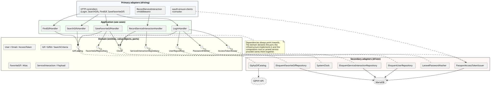
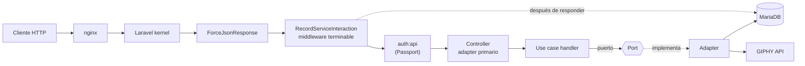
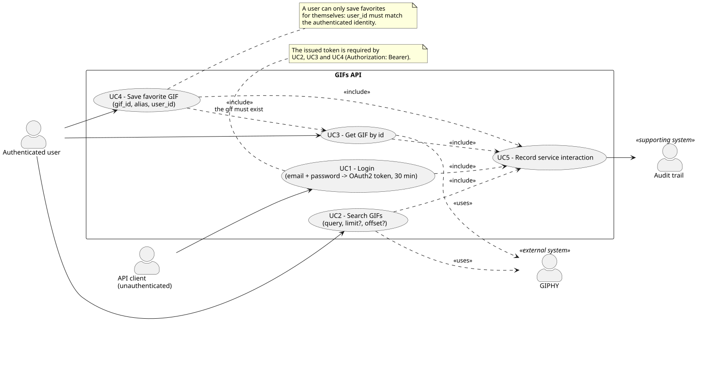
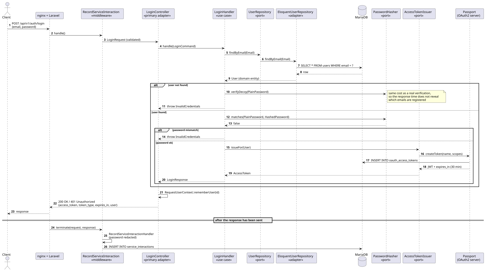
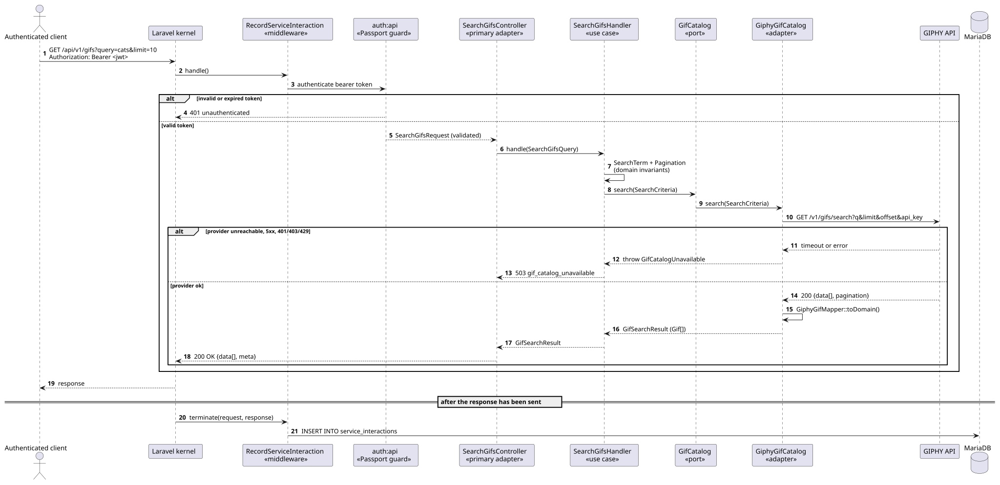
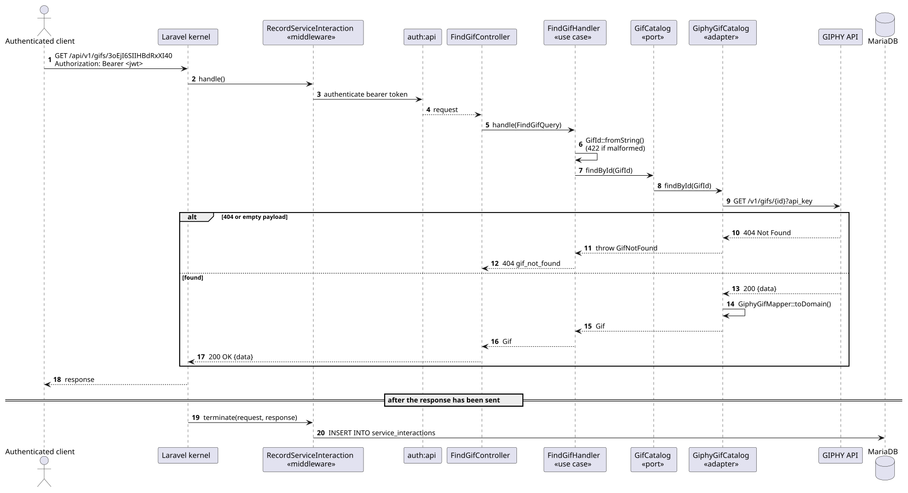
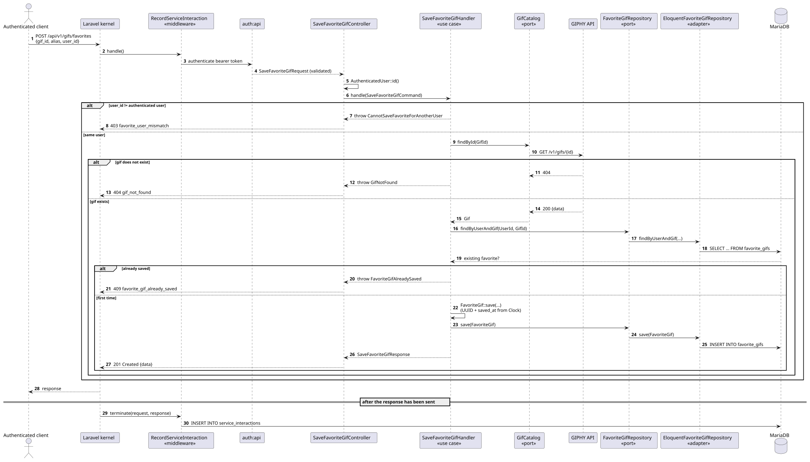
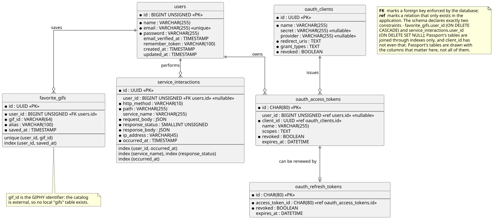
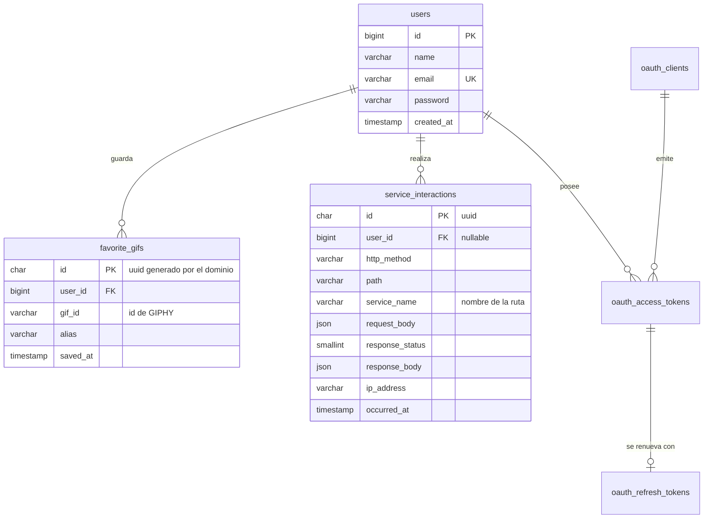

# Challenge PHP Hexagonal — GIFs API

API REST construida con **Laravel 12 / PHP 8.3** siguiendo **Arquitectura Hexagonal (Ports & Adapters) + DDD**,
que se integra con la API de **GIPHY**, autentica con **OAuth2** (tokens de 30 minutos) y **audita todas las
interacciones** con los servicios.

| | |
|---|---|
| **Stack** | PHP 8.3 · Laravel 12 · Laravel Passport (OAuth2) · MariaDB 11.4 · nginx · Docker |
| **Arquitectura** | Hexagonal + DDD · 3 bounded contexts (`Auth`, `Gifs`, `Audit`) + shared kernel |
| **Tests** | 149 tests / 318 assertions (unitarios, de arquitectura y de feature) |
| **Levantar todo** | `cp .env.example .env` → setear `GIPHY_API_KEY` → `docker compose up -d --build` |

---

## Tabla de contenidos

1. [Requisitos de la consigna y dónde se resuelven](#1-requisitos-de-la-consigna-y-dónde-se-resuelven)
2. [Puesta en marcha](#2-puesta-en-marcha)
3. [Servicios de la API](#3-servicios-de-la-api)
4. [Manejo de errores](#4-manejo-de-errores)
5. [Arquitectura](#5-arquitectura)
6. [Diagramas](#6-diagramas)
7. [Modelo de datos](#7-modelo-de-datos)
8. [Autenticación OAuth2](#8-autenticación-oauth2)
9. [Auditoría de interacciones](#9-auditoría-de-interacciones)
10. [Tests](#10-tests)
11. [Colección Postman](#11-colección-postman)
12. [Decisiones de diseño y supuestos](#12-decisiones-de-diseño-y-supuestos)
13. [Comandos útiles](#13-comandos-útiles)

---

## 1. Requisitos de la consigna y dónde se resuelven

| Requisito | Estado | Implementación |
|---|---|---|
| Arquitectura Hexagonal + DDD, separación Dominio / Aplicación / Infraestructura | ✅ | `src/<Contexto>/{Domain,Application,Infrastructure}` |
| Persistencia accedida vía puertos/repositorios del dominio (sin acceso directo desde controladores) | ✅ | `UserRepository`, `FavoriteGifRepository`, `ServiceInteractionRepository` (interfaces en `Domain`), adapters Eloquent en `Infrastructure` |
| Integración con la API de GIPHY | ✅ | Puerto `Gifs\Domain\GifCatalog` + adapter `Gifs\Infrastructure\Giphy\GiphyGifCatalog` |
| API REST con autenticación OAuth2 y códigos HTTP correctos | ✅ | Laravel Passport · `ApiExceptionRenderer` traduce errores de dominio a HTTP |
| Servicio **Login** (email + password → token con expiración de 30 min) | ✅ | `POST /api/v1/auth/login` |
| Servicio **Buscar GIFS** (query requerido, limit/offset opcionales) | ✅ | `GET /api/v1/gifs` |
| Servicio **Buscar GIF por ID** | ✅ | `GET /api/v1/gifs/{id}` |
| Servicio **Guardar GIF favorito** (gif_id, alias, user_id) | ✅ | `POST /api/v1/gifs/favorites` |
| Los servicios requieren autenticación | ✅ | Middleware `auth:api` (guard Passport) en las 3 rutas de gifs |
| Persistir toda interacción: usuario, servicio, body del request, status, body de la respuesta e IP | ✅ | Contexto `Audit` + middleware terminable `RecordServiceInteraction` |
| Tests unitarios o de feature | ✅ | 149 tests: `tests/Unit`, `tests/Architecture`, `tests/Feature` |
| PHP 8.3+ / Laravel 11+ / MariaDB o MySQL / Docker / UML | ✅ | `Dockerfile`, `docker-compose.yml`, `docs/diagrams/*.puml` |
| README con despliegue + diagramas de casos de uso, secuencia y DER + colección Postman con automatización del token | ✅ | Este archivo · `docs/diagrams` · `postman/` |

---

## 2. Puesta en marcha

### 2.1 Requisitos previos

* Docker y Docker Compose v2.
* Una API key de GIPHY (gratuita): <https://developers.giphy.com/docs/api/#quick-start-guide>

### 2.2 Pasos

```bash
# 1. Variables de entorno
cp .env.example .env

# 2. Cargar la API key de GIPHY en .env
#    GIPHY_API_KEY=tu_api_key

# 3. Levantar el stack (app php-fpm + nginx + MariaDB)
docker compose up -d --build
```

El entrypoint del contenedor es idempotente y se encarga de todo lo necesario en cada arranque:

1. genera `APP_KEY` si falta,
2. espera a que MariaDB esté disponible,
3. ejecuta las migraciones,
4. genera las llaves de firma OAuth2 (`passport:keys`),
5. crea los clientes OAuth2 si no existen (`oauth:ensure-clients`),
6. siembra el usuario demo (`db:seed`).

La API queda disponible en **<http://localhost:8080>** (puerto configurable con `APP_PORT`).

> El servicio `app` no usa `env_file`: el proyecto (incluido `.env`) se monta en el contenedor y Laravel lo lee
> directamente. Inyectar el mismo archivo como entorno del contenedor lo eclipsaría, porque una variable de
> entorno real siempre gana sobre `.env` — un `APP_KEY=` vacío rompería la aplicación aun después de que el
> entrypoint la complete.

### 2.3 Verificación rápida

```bash
# Health check
curl -s http://localhost:8080/up

# Login con el usuario demo creado por el seeder
TOKEN=$(curl -s -X POST http://localhost:8080/api/v1/auth/login \
  -H 'Content-Type: application/json' \
  -d '{"email":"demo@prex.local","password":"password"}' | jq -r .data.access_token)

# Buscar gifs
curl -s "http://localhost:8080/api/v1/gifs?query=funny%20cat&limit=3" \
  -H "Authorization: Bearer $TOKEN" | jq
```

**Credenciales demo:** `demo@prex.local` / `password` (configurables con `DEMO_USER_EMAIL` y `DEMO_USER_PASSWORD`).

### 2.4 Levantar el proyecto sin Docker (opcional)

```bash
composer install
cp .env.example .env            # configurar DB_* y GIPHY_API_KEY
php artisan key:generate
php artisan migrate
php artisan passport:keys
php artisan oauth:ensure-clients
php artisan db:seed
php artisan serve               # http://127.0.0.1:8000
```

Requiere un MariaDB (o MySQL) accesible: ajustá `DB_HOST`, `DB_DATABASE`, `DB_USERNAME` y `DB_PASSWORD`
en el `.env`. La aplicación corre siempre sobre MariaDB/MySQL; SQLite se usa únicamente como base de
la suite de tests (ver [Tests](#10-tests)).

---

## 3. Servicios de la API

Prefijo común: `/api/v1`. Todas las respuestas son JSON (`Accept: application/json` se fuerza por middleware).

| # | Servicio | Método y ruta | Auth | Éxito |
|---|---|---|---|---|
| 1 | Login | `POST /api/v1/auth/login` | — | `200` |
| 2 | Buscar GIFS | `GET /api/v1/gifs` | Bearer | `200` |
| 3 | Buscar GIF por ID | `GET /api/v1/gifs/{id}` | Bearer | `200` |
| 4 | Guardar GIF favorito | `POST /api/v1/gifs/favorites` | Bearer | `201` |

### 3.1 Login

**Entrada:** `email` (requerido), `password` (requerido).
**Salida:** token OAuth2 con expiración de 30 minutos (`expires_in` puede devolver 1799 en vez de 1800:
el servidor OAuth2 deriva la vida útil del instante exacto de emisión y el último segundo se pierde en
el redondeo).

```http
POST /api/v1/auth/login
Content-Type: application/json

{ "email": "demo@prex.local", "password": "password" }
```

```json
{
  "data": {
    "access_token": "eyJ0eXAiOiJKV1QiLCJhbGciOiJSUzI1NiJ9...",
    "token_type": "Bearer",
    "expires_in": 1800,
    "expires_at": "2026-10-16T04:19:00+00:00",
    "user": { "id": 1, "name": "Prex Demo User", "email": "demo@prex.local" }
  }
}
```

### 3.2 Buscar GIFS

**Entrada (filtros):** `query` requerido|cadena (hasta 50 caracteres, que es el máximo que acepta GIPHY: más largo responde `414`) · `limit` opcional|numérico (1–50, default 25) · `offset` opcional|numérico (0–4999, default 0).
**Salida:** colección con resultados de búsqueda + metadata de paginación.

```http
GET /api/v1/gifs?query=funny%20cat&limit=2&offset=0
Authorization: Bearer <token>
```

```json
{
  "data": [
    {
      "id": "3oEjI6SIIHBdRxXI40",
      "title": "Funny Cat GIF",
      "url": "https://giphy.com/gifs/3oEjI6SIIHBdRxXI40",
      "rating": "g",
      "username": "",
      "images": {
        "original": { "url": "https://media.giphy.com/.../giphy.gif", "width": 480, "height": 270, "size_in_bytes": 1048576 },
        "preview":  { "url": "https://media.giphy.com/.../200w_d.gif", "width": 200, "height": 112, "size_in_bytes": 32768 }
      }
    }
  ],
  "meta": { "count": 2, "total_count": 1375, "limit": 2, "offset": 0 }
}
```

> Los filtros también se aceptan en mayúsculas (`QUERY`, `LIMIT`, `OFFSET`), tal como figuran en la consigna.

### 3.3 Buscar GIF por ID

**Entrada:** `ID` requerido (ver [supuestos](#12-decisiones-de-diseño-y-supuestos) sobre el formato).
**Salida:** datos del recurso consultado.

```http
GET /api/v1/gifs/3oEjI6SIIHBdRxXI40
Authorization: Bearer <token>
```

```json
{ "data": { "id": "3oEjI6SIIHBdRxXI40", "title": "Funny Cat GIF", "url": "...", "rating": "g", "username": "", "images": { "...": "..." } } }
```

### 3.4 Guardar GIF favorito

**Entrada:** `GIF_ID` requerido · `ALIAS` requerido|cadena (1–100) · `USER_ID` requerido|numérico.
**Salida:** `201 Created` con el favorito creado y los datos del gif.

```http
POST /api/v1/gifs/favorites
Authorization: Bearer <token>
Content-Type: application/json

{ "gif_id": "3oEjI6SIIHBdRxXI40", "alias": "mi gato favorito", "user_id": 1 }
```

```json
{
  "data": {
    "id": "9f8c1b2e-5d4a-4c3b-9a1e-7f6d5c4b3a2e",
    "user_id": 1,
    "gif_id": "3oEjI6SIIHBdRxXI40",
    "alias": "mi gato favorito",
    "saved_at": "2026-10-14T03:49:00+00:00",
    "gif": { "id": "3oEjI6SIIHBdRxXI40", "title": "Funny Cat GIF", "...": "..." }
  }
}
```

Reglas de negocio aplicadas, en orden:

1. `user_id` debe coincidir con el usuario autenticado → `403 favorite_user_mismatch`.
2. El mismo usuario no puede guardar dos veces el mismo gif → `409 favorite_gif_already_saved`.
3. El gif debe existir en el catálogo → `404 gif_not_found`.

Las dos primeras se responden con lo que ya tenemos, así que un duplicado no gasta cuota de GIPHY ni
depende de que el proveedor esté en pie. La regla 2 la decide en última instancia el índice único
`(user_id, gif_id)`: dos peticiones simultáneas pasan ambas el chequeo previo, y la que pierde la carrera
recibe el mismo `409` en lugar de un `500`.

También acepta las claves en mayúsculas (`GIF_ID`, `ALIAS`, `USER_ID`).

---

## 4. Manejo de errores

Todos los errores comparten un único envelope:

```json
{ "error": { "code": "gif_not_found", "message": "No gif found with id \"abc\".", "context": { "gif_id": "abc" } } }
```

| HTTP | `error.code` | Cuándo ocurre |
|---|---|---|
| `401` | `unauthenticated` | Falta el token, es inválido o expiró |
| `401` | `invalid_credentials` | Email inexistente o password incorrecto (mismo mensaje para no filtrar qué emails existen) |
| `403` | `favorite_user_mismatch` | Se intenta guardar un favorito para otro usuario |
| `404` | `gif_not_found` | GIPHY no conoce ese gif, o rechaza el id (`400`/`414`/`422`) |
| `404` | `endpoint_not_found` | Ruta inexistente (incluye ids con caracteres no permitidos) |
| `409` | `favorite_gif_already_saved` | El usuario ya tenía ese gif como favorito |
| `422` | `validation_failed` | Falla la validación de entrada (`error.errors` detalla cada campo) |
| `422` | `invalid_gif_id`, `invalid_pagination`, `invalid_search_term`, `invalid_alias`, `invalid_email` | Se violó un invariante del dominio |
| `503` | `gif_catalog_unavailable` | GIPHY no responde, responde 5xx o rechaza la API key |
| `500` | `internal_server_error` | Error inesperado (el detalle sólo se expone con `APP_DEBUG=true`) |

La traducción de excepciones de dominio a códigos HTTP vive en un único lugar
(`src/Shared/Infrastructure/Http/Exception/ApiExceptionRenderer.php`): el dominio sólo expresa *qué* pasó
mediante interfaces marcadoras (`NotFound`, `Conflict`, `Unauthorized`, `Forbidden`, `ServiceUnavailable`).

---

## 5. Arquitectura

### 5.1 Idea general



* **Dominio** (`src/<Contexto>/Domain`): entidades, value objects, reglas de negocio y **puertos** (interfaces).
  No conoce Laravel: no hay un solo `use Illuminate\...` (está verificado por un test de arquitectura).
* **Aplicación** (`src/<Contexto>/Application`): un caso de uso por carpeta, con su `Command`/`Query` de entrada y
  su `Response` de salida. Depende sólo de puertos, nunca de adapters.
* **Infraestructura** (`src/<Contexto>/Infrastructure`): adapters primarios (controllers HTTP, middleware, comandos
  de consola) y secundarios (Eloquent, Passport, cliente HTTP de GIPHY).
* **Composition root**: `app/Providers/HexagonalBindingsServiceProvider.php` es el único lugar donde un puerto se
  asocia con su adapter. Cambiar MariaDB o GIPHY por otra cosa es cambiar una línea ahí.

### 5.2 Bounded contexts

| Contexto | Responsabilidad | Agregado raíz |
|---|---|---|
| `Auth` | Identidad y emisión de tokens OAuth2 | `User` |
| `Gifs` | Catálogo externo de GIFs y favoritos de cada usuario | `FavoriteGif` (+ `Gif` como snapshot de lectura) |
| `Audit` | Traza de todas las interacciones con los servicios | `ServiceInteraction` |
| `Shared` | Shared kernel: `UserId`, `Uuid`, `Clock`, excepciones base y utilidades HTTP transversales | — |

Los contextos no se conocen entre sí: sólo dependen del shared kernel (también verificado por test).

### 5.3 Estructura del proyecto

```
src/
├── Auth/
│   ├── Domain/              User, Email, PlainPassword, HashedPassword, AccessToken
│   │                        + puertos: UserRepository, PasswordHasher, AccessTokenIssuer
│   ├── Application/Login/   LoginCommand, LoginHandler, LoginResponse
│   └── Infrastructure/
│       ├── Persistence/Eloquent/   UserModel, UserMapper, EloquentUserRepository
│       ├── Security/               LaravelPasswordHasher, PassportAccessTokenIssuer
│       ├── Http/                   LoginController, LoginRequest, AccessTokenResource
│       └── Console/                EnsureOAuthClientsCommand
├── Gifs/
│   ├── Domain/              Gif, GifId, GifImage, SearchTerm, Pagination, SearchCriteria,
│   │                        GifSearchResult, Favorite/{FavoriteGif, Alias, FavoriteGifId}
│   │                        + puertos: GifCatalog, FavoriteGifRepository
│   ├── Application/         SearchGifs/, FindGif/, SaveFavoriteGif/
│   └── Infrastructure/
│       ├── Giphy/                  GiphyGifCatalog, GiphyGifMapper, GiphyConfiguration
│       ├── Persistence/Eloquent/   FavoriteGifModel, FavoriteGifMapper, EloquentFavoriteGifRepository
│       └── Http/                   3 controllers + requests + resources
├── Audit/
│   ├── Domain/              ServiceInteraction, ConsumedService, Payload, HttpStatusCode, IpAddress
│   │                        + puerto: ServiceInteractionRepository
│   ├── Application/         RecordServiceInteraction/
│   └── Infrastructure/      Middleware RecordServiceInteraction + persistencia Eloquent
└── Shared/
    ├── Domain/              Clock, UserId, Uuid, DomainException + interfaces marcadoras
    └── Infrastructure/      SystemClock, AuthenticatedUser, RequestUserContext,
                             ApiExceptionRenderer, ForceJsonResponse

app/            Sólo "pegamento" de framework: los dos service providers
bootstrap/      Rutas, middleware, comandos y renderer de excepciones
database/       Migraciones, factory y seeder
docs/diagrams/  Fuentes .puml + SVG renderizados
postman/        Colección + environment
docker/         Dockerfile auxiliar (php.ini, entrypoint) y config de nginx
```

### 5.4 Flujo de una request



---

## 6. Diagramas

Las fuentes UML están en [`docs/diagrams`](docs/diagrams) (PlantUML) junto con los SVG ya renderizados.
Para regenerarlos: `plantuml docs/diagrams/*.puml -tsvg` (o cualquier servidor PlantUML/Kroki).

### 6.1 Diagrama de casos de uso



### 6.2 Diagramas de secuencia

**UC1 — Login**



**UC2 — Buscar GIFS**



**UC3 — Buscar GIF por ID**



**UC4 — Guardar GIF favorito**



### 6.3 Diagrama de datos (DER)



---

## 7. Modelo de datos



* `favorite_gifs` tiene un índice único `(user_id, gif_id)`: la regla "un gif no se guarda dos veces" está
  garantizada también a nivel de base de datos.
* No existe tabla `gifs`: el catálogo es externo (GIPHY), por lo que sólo se persiste su identificador.
* Las tablas `oauth_*` son las de Passport (clientes, access tokens, refresh tokens, auth codes, device codes).

---

## 8. Autenticación OAuth2

El proyecto usa **Laravel Passport**, es decir un servidor OAuth2 completo: los tokens son JWT firmados con RSA
y registrados en `oauth_access_tokens`, y el guard `api` los valida en cada request.

* **Servicio de login de la consigna** — `POST /api/v1/auth/login` recibe `email` + `password`, valida las
  credenciales **en el dominio** (`User::authenticate()` + puerto `PasswordHasher`) y delega la emisión del token
  al puerto `AccessTokenIssuer`, implementado por Passport (`personal_access` grant).
* **Endpoint OAuth2 estándar** — además queda disponible `POST /oauth/token` con el `password` grant, para quien
  prefiera el flujo canónico:

  ```bash
  # el client_id lo imprime: php artisan oauth:ensure-clients
  curl -s -X POST http://localhost:8080/oauth/token \
    -H 'Content-Type: application/json' \
    -d '{"grant_type":"password","client_id":"<client-id>","username":"demo@prex.local","password":"password","scope":""}'
  ```

  Se puede desactivar con `OAUTH_ENABLE_PASSWORD_GRANT=false`.
* **Expiración de 30 minutos** — configurada en `config/oauth.php` (`OAUTH_ACCESS_TOKEN_TTL_MINUTES=30`) y
  aplicada a ambos flujos; la respuesta del login expone `expires_in: 1800` y `expires_at`.
* **Clientes OAuth2** — `php artisan oauth:ensure-clients` es idempotente (a diferencia de `passport:install`),
  por lo que puede ejecutarse en cada arranque del contenedor sin duplicar clientes.

---

## 9. Auditoría de interacciones

Requisito 3 de la consigna: *toda* interacción con los servicios se persiste en `service_interactions`.

| Dato pedido | Columna |
|---|---|
| Usuario que realizó la petición | `user_id` (nullable: un login fallido no tiene usuario) |
| Servicio consultado | `http_method`, `path`, `service_name` |
| Cuerpo de la petición | `request_body` (JSON) |
| Código HTTP de la respuesta | `response_status` |
| Cuerpo de la respuesta | `response_body` (JSON) |
| IP de origen de la consulta | `ip_address` |

Características de la implementación:

* **No agrega latencia**: el middleware es *terminable*, se ejecuta después de enviar la respuesta al cliente.
* **No puede romper la API**: si falla al auditar, se reporta al log y la respuesta del cliente no se altera.
* **Nunca guarda secretos**: `Payload::redacting()` reemplaza por `[redacted]` las claves sensibles configuradas
  en `config/audit.php` (`password`, `access_token`, `secret`, …) a cualquier nivel de anidamiento.
* **Acota el tamaño**: `Payload::truncated()` guarda un preview si el body supera `AUDIT_MAX_PAYLOAD_BYTES`.
* **Nada de lo que mande el cliente lo deja afuera**: `Payload` normaliza a UTF-8 válido al construirse, y
  trunca por caracteres y no por bytes. Sin eso, una petición con bytes inválidos (`?query=%FF`) hacía
  fallar el encoding de la fila y —justamente por el punto anterior— la interacción se perdía en silencio.
* **Audita también los errores**: un `401`, un `422` o un `503` quedan registrados con su body de error.
* Se puede desactivar con `AUDIT_ENABLED=false`.

Ejemplo de registro de un login exitoso:

```json
{
  "user_id": 1,
  "http_method": "POST",
  "path": "/api/v1/auth/login",
  "service_name": "auth.login",
  "request_body": { "email": "demo@prex.local", "password": "[redacted]" },
  "response_status": 200,
  "response_body": { "data": { "access_token": "[redacted]", "token_type": "Bearer", "...": "..." } },
  "ip_address": "172.18.0.1",
  "occurred_at": "2026-10-14 03:49:00"
}
```

---

## 10. Tests

```bash
make test              # toda la suite (~1 s)
make test-mariadb      # la misma suite, contra MariaDB
make test-unit         # unitarios + arquitectura
make test-feature      # sólo feature

# equivalentes sin Makefile
docker compose exec app php artisan test
docker compose exec -e TEST_DB_CONNECTION=mariadb app php artisan test
docker compose exec app php artisan test --testsuite=Feature
```

### ¿Por qué la suite corre sobre SQLite por defecto?

**La aplicación siempre usa MariaDB** (`config/database.php`, `docker-compose.yml`, `.env.example`): no hay
SQLite en ningún camino de ejecución productivo. La *suite de tests* es lo único que, por defecto, usa una
base SQLite **en memoria**, por tres razones:

* **velocidad**: ~1 s contra más de 20 s, lo que la vuelve ejecutable en cada cambio;
* **aislamiento**: nace y muere con el proceso, no deja estado entre corridas ni puede tocar datos reales;
* **cero dependencias**: `php artisan test` funciona en un clone recién hecho y en CI sin levantar servicios.

El riesgo conocido de ese atajo es que SQLite y MariaDB no se comportan igual (columnas `JSON`, índices
únicos, claves foráneas, modo estricto). Por eso **la misma suite corre también contra MariaDB** con
`make test-mariadb` (usa la base `prex_gifs_test`, nunca la de desarrollo), y el workflow de CI ejecuta los
dos motores en jobs separados. Si preferís que MariaDB sea el modo por defecto, alcanza con cambiar una
línea en `tests/bootstrap.php` (`$connection = $_SERVER['TEST_DB_CONNECTION'] ?? 'mariadb';`).

Resultado actual: **149 tests, 318 assertions, OK** en los dos motores (algo más de 1 s en SQLite en
memoria, algo más de 20 s en MariaDB). Ningún test necesita conexión a GIPHY: el proveedor se simula en el borde HTTP.

> **La suite nunca toca la base de desarrollo.** PHPUnit aplica los `<env>` de `phpunit.xml` a `$_ENV` y
> `putenv()`, pero el repositorio de entorno de Laravel lee `$_SERVER` primero: dentro del contenedor, donde
> `DB_CONNECTION`/`DB_HOST` son variables de entorno reales, la suite habría corrido contra MariaDB
> (migrándola y truncándola). `tests/bootstrap.php` sincroniza `$_SERVER` con lo que declara `phpunit.xml`,
> de modo que los tests siempre corren aislados.

| Suite | Qué cubre |
|---|---|
| `tests/Unit` (77) | Reglas de negocio aisladas: value objects (email, gif id, paginación, alias, payload, IP) y los 5 casos de uso con dobles en memoria (`InMemoryUserRepository`, `FakeGifCatalog`, `FakeAccessTokenIssuer`, `FixedClock`, …). Sin base de datos, sin HTTP, sin contenedor de Laravel. |
| `tests/Architecture` (21) | Las reglas de la arquitectura como código: el dominio no importa el framework, las dependencias apuntan hacia adentro, la aplicación no conoce adapters, los contextos sólo hablan por el shared kernel y todos los puertos viven en `Domain`. |
| `tests/Feature` (37) | Los 4 servicios end-to-end sobre el kernel HTTP real: login (token real de Passport usado luego en un endpoint protegido), búsqueda, detalle, favoritos, autorización, validaciones, caída del proveedor y persistencia de la auditoría. GIPHY se simula en el borde HTTP (`Http::fake`), el adapter que se ejercita es el real. |

El estilo de código se valida con Pint (preset Laravel): `./vendor/bin/pint --test`.

---

## 11. Colección Postman

En [`postman/`](postman) hay dos archivos para importar:

* `Prex-GIFs-API.postman_collection.json`
* `Prex-GIFs-API.postman_environment.json` (environment *Prex - Local*, `base_url = http://localhost:8080`)

**Automatización incluida:**

* El test de **Auth → Login** guarda en el environment `access_token`, `token_type`, `token_expires_at` y
  `user_id`; la colección usa `Bearer {{access_token}}` a nivel colección, así que el resto de los requests
  quedan autenticados automáticamente.
* Un script *pre-request* a nivel colección hace login solo si no hay token vigente, de modo que cualquier
  request se puede ejecutar aislado.
* **GIFs → Search GIFs** guarda el primer resultado en `gif_id`, que usan *Get GIF by id* y *Save favorite GIF*.
* Cada request incluye tests (status esperado, estructura de la respuesta, códigos de error de negocio), por lo
  que `Run collection` recorre el happy path y los casos de error 401/403/404/409/422.
* La colección es **re-ejecutable**: *Search GIFs* consulta una página aleatoria del catálogo y guarda un gif
  al azar, así *Save favorite GIF* siempre obtiene su `201` y el request siguiente demuestra el `409`.

También se puede ejecutar sin abrir Postman, con [newman](https://github.com/postmanlabs/newman):

```bash
# el client id del password grant lo imprime: docker compose exec app php artisan oauth:ensure-clients
docker run --rm --network challenge-prex_prex -v "$PWD/postman:/etc/newman:ro" postman/newman:alpine \
  run Prex-GIFs-API.postman_collection.json \
  -e Prex-GIFs-API.postman_environment.json \
  --env-var base_url=http://nginx \
  --env-var oauth_client_id=<client-id>
```

Resultado esperado: **25 assertions, 0 fallos**.

---

## 12. Decisiones de diseño y supuestos

1. **`GIF_ID` / `ID` alfanuméricos (desvío documentado).** La consigna los describe como *numéricos*, pero GIPHY
   identifica sus recursos con ids alfanuméricos (`3oEjI6SIIHBdRxXI40`). Restringirlos a dígitos haría inutilizable
   la integración real, así que el invariante implementado es "identificador alfanumérico, `-`/`_`, hasta 64
   caracteres" — que también acepta ids puramente numéricos. Ver `Gifs\Domain\GifId`.
2. **`USER_ID` se valida contra el usuario autenticado.** La consigna pide `USER_ID` como entrada de "guardar
   favorito", pero el servicio es autenticado: aceptar un id arbitrario permitiría escribir en la colección de
   otra persona. Se acepta el parámetro (compatibilidad con la especificación) y se exige que coincida con el
   dueño del token; si no, `403`.
3. **Guardar favorito valida que el gif exista** en el catálogo antes de persistirlo, para no dejar favoritos
   colgados — pero después de los chequeos de dueño y de duplicado, que se responden con lo que ya tenemos.
   Como efecto secundario, la respuesta `201` ya incluye los datos del gif.
4. **La salida de "guardar favorito" no es vacía.** La consigna no especifica salida; se devuelve `201 Created`
   con el recurso creado, que es lo habitual en REST y más útil para el cliente.
5. **Identidades generadas por el dominio.** `favorite_gifs` y `service_interactions` usan UUID v4 creados en el
   dominio (`FavoriteGifId::generate()`), no autoincrementales: el agregado está completo antes de persistirse y
   los casos de uso se testean sin base de datos.
6. **`503` para fallas de GIPHY, `404` para ids que no llevan a ningún lado.** Una caída del proveedor se
   traduce a `503 Service Unavailable` (`gif_catalog_unavailable`), con reintentos sólo ante fallas transitorias
   (timeout, 5xx, 429), nunca ante `404`/`401`. En cambio un `400`/`404`/`414`/`422` del proveedor *sobre un id*
   es un `404 gif_not_found`: el cliente no puede hacer nada con un "servicio no disponible" que en realidad
   significa "ese id no existe". El mensaje de un error de transporte nunca se reenvía tal cual, porque lleva la
   URL completa de la petición con la `api_key` adentro.
7. **Login no revela si el email existe**, ni por la respuesta ni por el tiempo: email inexistente y password
   incorrecto devuelven el mismo `401 invalid_credentials`, y la rama del email inexistente gasta una
   verificación igual (`PasswordHasher::verifyDecoy`) para no responder diez veces más rápido.
8. **El shared kernel aloja `UserId`** porque tres contextos necesitan referenciar al usuario; `Gifs` y `Audit`
   nunca dependen de `Auth`.
9. **El token se emite con el `personal_access` grant** de Passport en el servicio de login (para poder recibir
   `email`/`password` tal como pide la consigna y responder con un payload propio), manteniendo además el
   endpoint OAuth2 estándar `/oauth/token`.
10. **Sin frontend**: se quitaron Vite/npm del skeleton de Laravel; el proyecto es sólo API.
11. **La auditoría es inesquivable.** `Payload` garantiza UTF-8 válido al construirse: sin eso, una petición con
    bytes inválidos (`?query=%FF`) hacía fallar el encoding de la fila, el middleware se tragaba el error para no
    romper la respuesta, y la interacción terminaba sin registrarse. Persistir *toda* interacción es un requisito
    de la consigna, así que la validez del payload es un invariante del dominio, no un detalle del adaptador.
12. **El índice único es la única autoridad sobre duplicados.** "Leer y después insertar" no puede ser atómico:
    dos peticiones concurrentes pasan las dos el chequeo previo y una choca contra `(user_id, gif_id)`. El
    repositorio traduce esa violación a `409`, así que la carrera responde lo mismo que el camino secuencial.

---

## 13. Comandos útiles

Hay un `Makefile` con atajos (`make help` los lista):

| Comando | Qué hace |
|---|---|
| `make up` | Copia `.env` si falta, construye y levanta el stack |
| `make down` / `make logs` | Detiene el stack / sigue los logs |
| `make shell` | Abre una shell en el contenedor `app` |
| `make test` | Corre toda la suite |
| `make fresh` | Recrea el esquema, los clientes OAuth2 y los datos demo |
| `make routes` | Lista las rutas de la API |
| `make pint` | Aplica el estilo de código |

Equivalentes con artisan dentro del contenedor:

```bash
docker compose exec app php artisan route:list --path=api
docker compose exec app php artisan oauth:ensure-clients
docker compose exec app php artisan migrate:fresh --force
docker compose exec app php artisan db:seed --force
```
